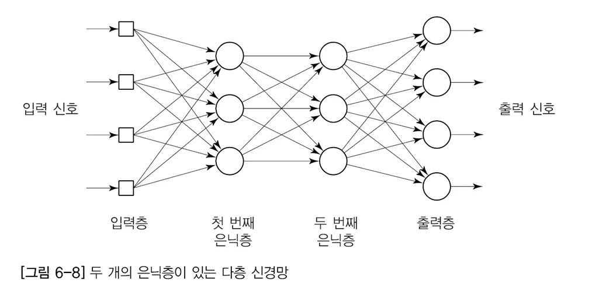

# 4-1. Deep Learning

- neural network with more than two hidden layers




Each neuron calculates a weighted sum and applies an activation function:

$$
z=\sum_i w_i x_i+b
$$

$$
y_d = f(z)
$$

- $x_i$: input data
- $w_i$: weight
- $b$: bias
- $y_d$: predicted output

 

- backpropagation training


$$
\boxed{w_{jk}(p+1)=w_{jk}(p)+\Delta w_{jk}(p)}
$$

$w_{jk}(p+1) : $	Updated weight after the next training step
$w_{jk}(p) : $	Current weight
$\Delta w_{jk}(p) : $	Change applied to the weight
$p : $	Training-step or iteration index
$j,k : $	Indices identifying the neurons connected by the weight


$$
\Delta w_{jk}(p)=\alpha \times y_j(p)\times \delta_k(p)
$$

$\Delta w_{jk}(p) : $	Change in the connection weight
$\alpha : $	Learning rate
$y_j(p) : $	Output of the sending neuron j
$\delta_k(p) : $	error gradient for neuron k
$p : $	Training iteration or pattern index

$$

\delta_k(p)=
\frac{\partial y_k(p)}{\partial X_k(p)}
\times e_k(p)
$$

The equation means:
Local error signal = derivative of the neuron's output × prediction error.

$\delta_k(p) : $	Local error signal for neuron \(k\)
$y_k(p) : $	Actual output of neuron \(k\)
$X_k(p) : $	Net input to neuron \(k\), before its activation function
$\frac{\partial y_k}{\partial X_k} : $	Derivative of the activation function
$e_k(p) : $	Desired output minus actual output
$p : $ Training pattern or iteration index


the error signal in a neural network during training
$$
e_k(p)=y_{d,k}(p)-y_k(p)
$$


```python

import numpy as np
import matplotlib.pyplot as plt

'
# ============================================================
# 1. XOR training data
# ============================================================

X = np.array([
    [0, 0],
    [0, 1],
    [1, 0],
    [1, 1]
])

T = np.array([0, 1, 1, 0])


# ============================================================
# 2. Sigmoid function
# ============================================================

def sigmoid(x):
    return 1 / (1 + np.exp(-x))


# ============================================================
# 3. Initialize weights and thresholds
# ============================================================

np.random.seed(42)

w13 = np.random.uniform(-1, 1)
w23 = np.random.uniform(-1, 1)

w14 = np.random.uniform(-1, 1)
w24 = np.random.uniform(-1, 1)

w35 = np.random.uniform(-1, 1)
w45 = np.random.uniform(-1, 1)

# Thresholds (constant input = -1)
theta3 = np.random.uniform(-1, 1)
theta4 = np.random.uniform(-1, 1)
theta5 = np.random.uniform(-1, 1)

alpha = 0.5
epochs = 30000

loss_history = []


# ============================================================
# 4. Training
# ============================================================

for epoch in range(epochs):

    total_error = 0

    for p in range(4):

        x1, x2 = X[p]
        target = T[p]

        # ----------------------------------------------------
        # STEP 1: Forward propagation
        # ----------------------------------------------------

        # Hidden neuron 3
        net3 = x1*w13 + x2*w23 - theta3
        y3 = sigmoid(net3)

        # Hidden neuron 4
        net4 = x1*w14 + x2*w24 - theta4
        y4 = sigmoid(net4)

        # Output neuron 5
        net5 = y3*w35 + y4*w45 - theta5
        y5 = sigmoid(net5)

        # ----------------------------------------------------
        # STEP 2: Calculate error
        # ----------------------------------------------------

        error = target - y5

        total_error += 0.5 * error**2

        # ----------------------------------------------------
        # STEP 3: Output neuron delta
        # ----------------------------------------------------

        delta5 = y5 * (1 - y5) * error

        # ----------------------------------------------------
        # STEP 4: Hidden neuron deltas
        # Use current weights before updating
        # ----------------------------------------------------

        delta3 = y3 * (1 - y3) * delta5 * w35

        delta4 = y4 * (1 - y4) * delta5 * w45

        # ----------------------------------------------------
        # STEP 5: Weight updates
        # ----------------------------------------------------

        # Hidden -> Output
        w35 += alpha * y3 * delta5
        w45 += alpha * y4 * delta5

        # Input -> Hidden
        w13 += alpha * x1 * delta3
        w23 += alpha * x2 * delta3

        w14 += alpha * x1 * delta4
        w24 += alpha * x2 * delta4

        # ----------------------------------------------------
        # STEP 6: Threshold updates
        # Constant input = -1
        # ----------------------------------------------------

        theta3 -= alpha * delta3
        theta4 -= alpha * delta4
        theta5 -= alpha * delta5

    loss_history.append(total_error)

    if epoch % 3000 == 0:
        print(f"Epoch {epoch:5d}, SSE={total_error:.6f}")


# ============================================================
# 5. Test trained network
# ============================================================

print("\nXOR Test Results")
print("-" * 55)

correct = 0

for p in range(4):

    x1, x2 = X[p]

    y3 = sigmoid(x1*w13 + x2*w23 - theta3)
    y4 = sigmoid(x1*w14 + x2*w24 - theta4)

    y5 = sigmoid(y3*w35 + y4*w45 - theta5)

    prediction = int(y5 >= 0.5)

    if prediction == T[p]:
        correct += 1

    print(
        f"Input=({x1},{x2}) "
        f"Target={T[p]} "
        f"Output={y5:.4f} "
        f"Prediction={prediction}"
    )

print(f"\nAccuracy = {correct/4*100:.1f}%")


# ============================================================
# 6. Print trained weights and thresholds
# ============================================================

print("\nFinal Weights")
print("-" * 30)

for name, value in [
    ("w13", w13), ("w23", w23),
    ("w14", w14), ("w24", w24),
    ("w35", w35), ("w45", w45),
    ("theta3", theta3),
    ("theta4", theta4),
    ("theta5", theta5)
]:
    print(f"{name:8s} = {value:.6f}")


# ============================================================
# 7. Plot training error
# ============================================================

plt.figure(figsize=(8, 4))
plt.plot(loss_history)
plt.xlabel("Epoch")
plt.ylabel("Sum of Half-Squared Errors")
plt.title("XOR Backpropagation Training")
plt.grid(True)
plt.show()


```


